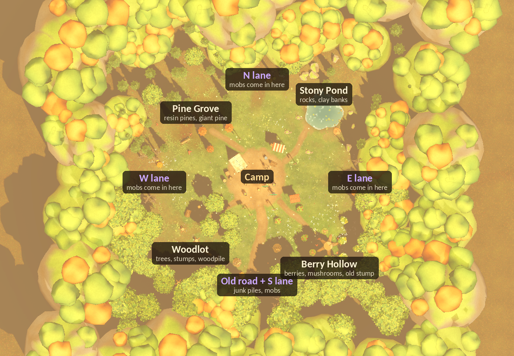

# Feature 032: World layout

## Why
The map read as scattered with no concept:
- **Resources:** every resource type was sprinkled evenly around the camp, in a ring.
- **Decor:** toadstools and boulders were placed at random angles.
- **Border:** the forest was one uniform ring.

Nothing told the player where things are or where the night comes from.

## Concept: the camp in a forest clearing

**Structure, from the middle out:**
1. **Camp yard** (r < 5.8): the dirt yard, the homestead and the fire.
2. **Mob lanes** (N, E, S, W along the axes):
   - open, trodden corridors 6 m wide;
   - darker trails painted on the ground;
   - a gap in the forest wall, dead trees and a jack-o'-lantern at each lane mouth.
   - Nothing solid stands in a lane, so mobs (who walk straight) never snag.
3. **Four groves** in the corners between the lanes. Each one has the resource it supplies, its own ground, a landmark and a matching stretch of forest wall:

| Corner | Grove | Resources | Ground | Landmark and dressing | Wall behind |
|---|---|---|---|---|---|
| NW | **Pine Grove** | resin pines | rusty needle litter, ferns | a giant old pine, green pines, a fallen log, toadstools | pines |
| NE | **Stony Pond** | rocks, clay pits on the banks | cool gravelly patches, a mud bank | the pond (water, reeds, lily pads, rim stones), boulders | pines and boulders |
| SW | **Woodlot** | broadleaf trees | warm leaf litter | cut stumps, a woodpile, a chopping stump, a felled log | broadleaf woods |
| SE | **Berry Hollow** | berry bushes, mushrooms | lush deep green, most of the wildflowers | a giant old stump with a fairy ring, flowering bushes | broadleaf woods, flower bushes |

4. **Footpaths** lead from the yard to each grove. The **old road** runs south along the south lane, with the junk piles on its verges.
   - Lantern posts mark where the paths leave the yard.
   - The signpost stands where the road and the woodlot path part.
5. **Forest wall and backdrop:** as before (hills and mountains), but the species follow the grove in front.

**Camera rules (it looks north from the south):**
- **Height.** Tall decor goes north of where you play, or at the very back (z > 16.5) of the southern groves, so it never hides the kids.
- **Shadows.** The sun throws shadows north, so nothing tall stands just south of a lane or the yard. That is why the Berry Hollow's landmark is a low giant stump and not an oak.

## How
- **`WorldLayout`** (`game/scripts/world/world_layout.gd`) holds the plan as data: zones, grove circles, path polylines, lanes and the pond. It also has the queries (`on_path`, `in_lane`, `zone_at`, ...).
  - It pushes the plan to the ground shader at load (`apply_to_ground`), so the shader and the dressing can no longer drift apart.
- **`painted_ground.gdshader`** paints the paths (from segment arrays), the grove grounds, the lane trails and the pond's mud bank.
- **`world_dressing.gd`** builds the groves (`_build_groves`), a zone-aware grass and flower scatter, ferns and reeds (MultiMesh), the pond, and a wall with lane gaps.
- **`pond_water.gdshader`** is opaque painted water; it needs no screen or depth texture.
- **`TestWorld.tscn`**: the resource nodes moved into their groves. The counts are unchanged.
- **`tests/sim/map_overview.tscn`** renders the map plan, oblique and game-camera views for layout review.
