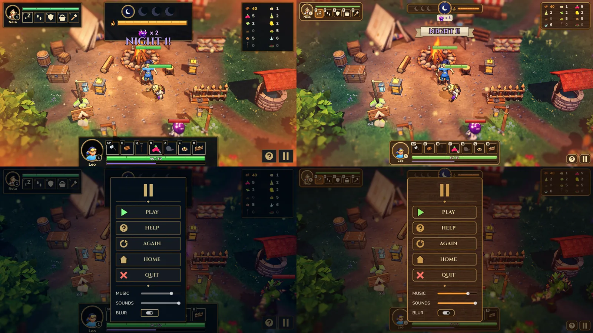

# Feature 033: Campcraft HUD, menus and overlays

## Why
- **Too big.** The top-centre plate (day clock, moons, campfire bar, imp row) was about 470×145 px at 1600×900, and grew at night. The DAY/NIGHT banner landed on it and on the fire. The tray, hero bar and Nela frame were oversized too: together the HUD covered about 18 % of the screen.
- **Wrong style.** The UI used a navy-and-gold "hextech" esports style that clashed with the golden-diorama art direction ("wood and canvas, crates, barrels, lanterns").

## What
- **Style.** A "campcraft" UI: walnut plates, brass rims and rivets, cream canvas tabs and ribbon, ember and moon accents, rounded warm bars. See [art direction §UI](../../docs/design/art-direction.md).
- **Artwork.** Generated by `art/ui/hud_kit.py` as 9-slice PNGs in `game/assets/ui/hud/`, wrapped by `UiKit.art_style()`. Because the theme uses them, every menu picks up the look.
- **Top centre.** One slim strip, 330×44 in base pixels (1280×720): the nights-to-win moons, the day-dial medallion (which overhangs the strip) and the campfire bar. The night imp count is a canvas tag hanging under the dial. Banners show on a ribbon below the strip.
- **Other plates.** Nela frame, resource tray (3 columns), hero bar, help and pause are all tightened. Plates anchor to their screen edges and size to their content.
- **World overlays.** Health bars use the same palette with a brass rim.
- **Menus.** Navy gradients become warm brown, the neon greens become leaf green, and the crafting panel's buttons are smaller.

