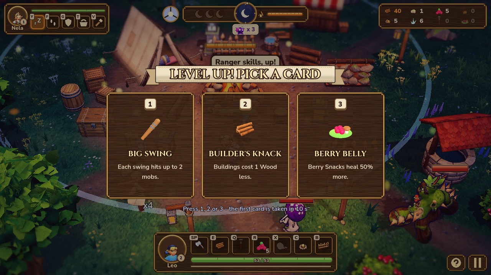

# Game design specification

> Companion document to
> [`docs/requirements/requirements.md`](../requirements/requirements.md). This
> file describes the game itself: loops, characters, systems, content.

## A. High-level pitch

Leo (7) and his little sister Nela must protect their campsite from the
shadows of the forest by gathering resources, crafting tools, building
defenses, giving the companion tasks, and surviving increasingly
dangerous nights. The shadows are not evil: they are lost things,
cold and drawn to the light (see [`story.md`](story.md)).

By day, the woods are cozy and inviting: birdsong, dappled light,
gatherable plants and rocks. At sunset, light fades and shadows lengthen.
At night, the trees press in and shapes move at the edge of vision. The
campfire is the heart of safety; everything is about keeping it lit and
your family alive until dawn.

The story (an adventure: mum is missing, the moon has gone dark, and the
kids must fill the old Moon Lantern again) is in [`story.md`](story.md):
the cast, the creatures' place in it, the named places and Mum's notes.

## B. Core gameplay loop

### Day

1. Wake up at camp.
2. Review base damage and resource stockpile.
3. Explore nearby woods.
4. Gather resources (wood, stone, berries, etc.).
5. Assign companions to tasks (gather, repair, scout, guard).
6. Craft items, tools, traps.
7. Build or repair defenses (fences, watch posts).
8. Prepare before sunset (top up health, stock arrows / supplies, position
   companions).

### Night

1. Mobs emerge from the forest.
2. The base comes under attack.
3. The player directly controls the boy.
4. Companions execute their assigned roles (guard, follow, support).
5. Defend the campfire / tent / base core.
6. Defeat mobs.
7. Earn XP and salvage / loot.
8. Survive until morning.

### Meta-progression

1. Level up characters with XP earned across day and night.
2. Unlock stronger buildings and crafting recipes.
3. Improve base layout (fence rings, choke points, watch posts).
4. Survive stronger nights (more mobs, new mob types).
5. Explore deeper forest areas (further from camp, higher reward / risk).

## C. Player character &mdash; the Boy

**Identity:** brave but small. Fast and flexible. Resourceful rather than
overpowered. He can do everything (gather, craft, build, fight) at a
modest level; companions specialize.

### Initial stats (placeholder values)

| Stat            | Description                                         | Initial |
|-----------------|-----------------------------------------------------|---------|
| Health          | Damage he can take before being knocked down.       | 50      |
| Stamina         | Sprint / dodge resource. Regenerates over time.     | 100     |
| Courage         | Resists fear effects. Mob proximity reduces actions.| 50      |
| Build Speed     | How fast he places / repairs structures.            | 1.0     |
| Gather Speed    | How fast he harvests resource nodes.                | 1.0     |
| Attack Power    | Damage per swing of his small weapon.               | 5       |
| Crafting Skill  | Discount / speed bonus on crafting actions.         | 1.0     |

All numbers are placeholder until balancing.

### Level-up effects

- Every level grants a small flat boost to max HP and attack damage,
  and a perk card (see [J. XP and leveling](#j-xp-and-leveling)).
- The numbers live in a `CharacterStatsDefinition` per hero
  (`game/resources/progression/`, see the architecture doc).

## D. Companions

### Heroes and hero select (feature 034)

Before a run (after picking 3 or 7 nights) the player chooses a hero on
the "Choose your hero" screen. Today the heroes are **Leo** (a melee
stick-fighter: tough, hits hard, short reach) and **Nela** (a slinger:
shoots pebbles from range, less health). The hero not picked comes along
as the AI companion and takes tasks as described below. A hero plays the
same way in either role, and keeps their signature craft: the Sturdy
Stick upgrades Leo, the Slingshot upgrades Nela. With more heroes, the
screen gets a second step to pick the companion. The autosave remembers
the party, so Continue skips the screen.

Family members and pets form a small team around the boy. Each companion
has a clear role.

> **Superseded by the story (035, 043):** the companion is the other
> sibling. Mum is the missing parent, so there is no Parent companion,
> and there are no pets (the dog on Mum's sheet is concept flavour). The
> roles below are kept as the original design notes.

### Parent Companion

- Repairs and defends.
- Can calm scared characters (resets fear).
- Durable, slower.
- Strong in melee, weak at range.

### Sibling Companion

- Gathers and scouts.
- Faster, less durable.
- Can dash to evade mobs.

### Dog Companion

- Detects mobs early (alert radius around camp).
- Distracts and chases small mobs (taunts).
- Best scouting role.

### Cat Companion

- Stealthy scout.
- Finds rare resources (Glow Shards bonus chance).
- Avoids direct combat.

**For the first prototype, only two companions are implemented** &mdash;
recommended: **Sibling** (gather / scout focus) and **Dog** (guard /
distract focus). They cover the two most distinct task patterns.

## E. Companion task system

### Task types (full list)

- **Idle** &mdash; stand at last position.
- **Follow Player** &mdash; stay within X meters of the boy.
- **Gather Resource** &mdash; walk to the nearest matching resource node
  and harvest until full / depleted, then deposit at the base.
- **Guard Base** &mdash; stay near the campfire core and engage approaching
  mobs.
- **Repair Building** &mdash; find the lowest-HP damaged building and
  repair it.
- **Craft Item** &mdash; stand at a crafting station and produce queued
  items.
- **Scout Area** &mdash; patrol a defined point or sweep a radius and
  report sightings.
- **Support Combat** &mdash; assist the player&rsquo;s current target.

### Prototype subset

For the first prototype, implement only:

- **Follow Player**
- **Gather Resource**
- **Guard Base**

Other tasks are stubbed out in the data layer (so the UI can list them) but
not behaviorally implemented yet.

### Assignment UI (prototype)

- Select a companion with the mouse.
- Press a hotkey or click a HUD button to set their task.
- Display the current task above the companion or in the HUD panel.

## F. Resource system

*Playtest 1 (feature 044) cut the list from 10 raw resources to 6.*
Testers found 10 too many to keep track of. Fiber, Leaves, Resin and
Mushrooms are gone, and their recipes use the remaining six instead.
Pine trees give wood, and mushroom patches are now only scenery.

| Name        | Rarity   | Cap | Source | Uses |
|-------------|----------|-----|--------|------|
| Wood        | Common   | 20  | Trees and pines | Every building, torches, Feed the Fire, repairs, table crafts |
| Stone       | Common   | 20  | Rocks | Watch Post, Crate, Table, Reinforced Wall, Stone Hearth |
| Berries     | Common   | 20  | Berry bushes | Eat (R), Berry Snack, Bandage |
| Clay        | Uncommon | 20  | Clay pits in the NE and SW corners | Reinforced Wall, Stone Hearth |
| Scrap       | Rare     | 20  | Junk piles near the E and S spawn lanes | Trap, Lantern, Table, Sturdy Stick, Slingshot, Trap Refill |
| Glow Shards | Rare     | 10  | Imps (40% chance per kill, with pity) and every bramble beast | Glow Lantern, the Moon Lantern |

Each Storage Crate adds another cap's worth. The crafted items (Torch,
Berry Snack and Bandage) have no cap.

### Display

Each resource has:

- A display name (above).
- A short description (above).
- An icon (placeholder is a colored square per resource).
- A rarity tier (used for spawn weights and UI tinting).
- A stack size (used by storage UI).
- A list of initial uses (used by hint UI).

These are stored as `ResourceDefinition` `.tres` files; see the architecture doc.

### Gathering

- Resource nodes appear in the world (tree, rock, berry bush).
- Approaching and interacting (button-press) starts a short gather timer.
- On finish, the boy (or companion) gains N units of the matching resource.
- Nodes have a small respawn / regrowth timer.

## G. Building system

### Building catalog

| Building       | Purpose                                                      |
|----------------|--------------------------------------------------------------|
| Campfire Core  | Central base object; mobs target it; provides light radius.  |
| Wooden Fence   | Cheap barrier; blocks or slows mobs. 3 Wood.                 |
| Watch Post     | Elevated post; companions can guard from here. 5 Wood + 2 Stone. |
| Storage Crate  | *(019)* +20 stash cap per resource (caps start at 20). 4 Wood + 2 Stone. |
| Crafting Table | *(019)* A second crafting station with the Sturdy Stick, Slingshot, Bandage and Trap Refill. 4 Wood + 2 Stone + 1 Scrap. |
| Reinforced Wall | *(019)* 150 HP, three times a fence. 3 Stone + 2 Clay + 1 Wood. |
| Snap Trap      | *(017)* Snaps the first imp on it: 10 damage, held 2.5 s; 3 snaps. 3 Wood + 1 Scrap. |
| Glow Lantern   | *(017)* A torch that never burns out: slows and zaps imps within 5 m. 2 Glow Shards + 1 Scrap + 2 Wood. |

### Prototype subset

- **Campfire Core** (pre-placed in the test world, not built).
- **Wooden Fence** (placeable by the player).
- **Watch Post** (placeable by the player, companions can be assigned).

### Build mode

- The player toggles build mode (e.g. with **B**).
- A &ldquo;ghost&rdquo; building follows the cursor.
- Green ghost = valid placement; red ghost = invalid (overlapping, off
  terrain, or insufficient resources).
- Left-click commits placement and spends resources.
- Right-click or Esc cancels build mode.

*Construction (playtest 1, feature 044):*
- A placed building is a **blueprint**: a see-through blue ghost of the
  finished shape on a staked-out site (corner stakes, a rope line and a
  small pile of what it costs), with a blue progress bar. It does
  nothing yet: no light, aura, trap, crate cap or table recipes.
- Its HP starts at 20% and grows as it is built.
- An idle hero walks to the oldest blueprint and hammers it up. Each
  building has its own `build_seconds` (2–4 s). Right-clicking a
  blueprint sends the hero to it.
- Builders take out a wooden mallet (Leo's stick and Nela's lantern are
  put away) and work in a beat of two overhead blows, then fetching a
  plank or fiddling a peg in (feature 045). Each blow throws wood chips,
  squashes the building a little and flashes the ghost. Repairs use the
  mallet too.
- As the work goes on, the solid building rises inside the ghost from
  the bottom up (a glowing build line marks the edge) and the material
  pile shrinks.
- The companion's Repair task builds blueprints before it repairs.
- When the building is finished the ghost fades, the site sinks away,
  the building bounces with dust and a gold sparkle, and the builder
  gets the build XP.
- Clicking an unstarted blueprint in build mode takes it back with a full
  refund.

### Auto-attack

*Playtest 1 (feature 044):* when the hero is idle or gathering, it fights
the nearest mob within max(attack range × 1.3, 3.5 m) on its own. When
that mob is beaten it moves on to the next one, then goes back to the
gather it left. A player command or WASD always wins. The pause menu's
**Auto-fight** switch turns it off.

### Building health and repair

- Each building has HP.
- Mobs attacking buildings reduce HP.
- HP at zero destroys the building (no repair allowed).
- Players or companions with the Repair task can restore HP at a fraction
  of the original resource cost.
  *Feature 017:*
  - Leo right-clicks a damaged building, walks over and hammers it. Each
    tap costs 1 Wood and restores 12 HP.
  - The campfire is fed at the crafting panel (Feed the Fire: 1 Wood,
    +20 HP).
  - Nela's Repair task (**V**) fixes the most damaged structure, the
    campfire first when it is low. She guards the camp when there is
    nothing to fix.
  - Snap Traps are rebuilt, not repaired.

## H. Crafting system

### Recipes

*Since playtest 1 (feature 044):*

| Recipe | Station | Inputs | Result |
|--------|---------|--------|--------|
| Feed the Fire | Campfire | 1 Wood | +20 campfire HP (only while it is damaged) |
| Torch | Campfire | 2 Wood | A torch (plant with Q) |
| Berry Snack | Campfire | 3 Berries | A snack (R: +35 HP) |
| Stone Hearth | Campfire | 5 Clay + 4 Stone | Campfire +75 max HP, fully healed; once per run |
| Bandage | Table | 2 Berries + 1 Wood | X next to the companion: +25 HP, or a revive |
| Sturdy Stick | Table | 4 Wood + 2 Scrap | Leo +2 attack; once per run |
| Slingshot | Table | 3 Wood + 2 Scrap | Nela's range; once per run |
| Trap Refill | Table | 1 Wood + 1 Scrap | Restores a Snap Trap |

These numbers live in the `CraftingRecipe` resources
(`game/resources/recipes/`).

### Prototype subset

Implement **one** recipe end-to-end (recommended: **Torch** &mdash; small,
useful at night, exercises three resources). The other recipes exist in
data only.

### Crafting flow

1. Player opens a crafting menu (key or by interacting with a station).
2. UI lists known recipes; locked recipes show their requirements.
3. Selecting a recipe checks resource availability and shows confirmation.
4. Confirming consumes resources, shows a small craft-time bar, and
   produces the item.
5. Crafting grants XP to the crafter.

## I. Mob system

### Mob catalog

| Mob              | Behavior summary                                              |
|------------------|---------------------------------------------------------------|
| Shadow Imp       | Small, fast, weak. Attacks structures and characters alike.   |
| Bramble Beast    | Slow, durable. Specializes in destroying fences.              |
| Night Crow       | Flying scout / harasser. Damages soft targets and flees. (Not planned: no place in the story.) |
| Mushroom Gremlin | Steals resources from the base, then runs.                    |

### Prototype subset

Implement **Shadow Imp** only.

*Feature 021:* the **Mushroom Gremlin** is in.
- It runs to the stash (a Storage Crate, else the campfire) and takes up
  to 4 of the most plentiful raw resource.
- Then it flees to its spawn point.
- Caught, it drops the loot as a pickup; escaped, the loot is gone.
- It has 8 HP, is fast, and ignores the kids.
- Waves: nights 1–3 have 0, 1, 1 gremlins, then +1 per night, in the
  first half of the wave.

*Feature 018:* the **Bramble Beast** is in.
- It walks to the nearest building and tears it down (×3 damage), then
  goes for the campfire.
- It ignores the kids unless they come within 2 m, and barely flinches
  when hit.
- It has 40 HP and always drops a Glow Shard.
- Waves: nights 1, 2 and 3 have 0, 1 and 2 beasts, spawned in the second
  half of the wave.

### Mob lifecycle

1. **Spawning** &mdash; appears at a designated edge of the map at night.
2. **Moving to target** &mdash; uses Godot navigation to approach a target
   (closest building, campfire core, or character).
3. **Attacking** &mdash; melee or ranged hit on the current target.
4. **Dying** &mdash; HP at zero plays a short death effect, awards XP and
   possibly drops a resource, then frees the node (or returns it to a
   pool).

### Wave logic

- Night start triggers a `MobSpawner` to begin spawning at intervals.
- A wave is a count, e.g. 6 Shadow Imps over 20 seconds for the first
  night.
- When all mobs in the wave are defeated *or* a wave timer expires, the
  wave ends and `night_ended` is signaled.

### Pacing

*Playtest 1 (feature 044) slowed the game down.* Testers found the
movement, fights and day/night cycle too fast.

| | Before | Since 044 |
|---|---|---|
| Day / sunset / night / dawn | 120 / 10 / 75 / 5 s | 200 / 12 / 120 / 6 s |
| Hero and companion speed | 5.0 and 4.8–4.9 m/s | 4.0 and 3.9 m/s |
| Imp / bramble / gremlin / Moon-Eater speed | 2.4 / 1.5 / 3.1 / 0.9 | 1.9 / 1.2 / 2.5 / 0.75 |
| Attack cooldowns | Leo 0.5, Nela 0.6, mobs 1.0–3.0 s | ×1.25 (Leo 0.65, Nela 0.75) |
| Spawn interval | 4.0 s | 5.5 s |
| Hero regen | 1.5 HP/s | 1.2 HP/s |

HP and damage did not change, so a fight takes the same number of hits
but more time. The durations live in `TimeManager`, the speeds in the
hero and mob `.tres` files.

## J. XP and leveling

### XP sources

Characters gain XP from:

- Defeating mobs.
- Building structures.
- Crafting items.
- Gathering resources.
- Repairing base objects.
- Surviving nights (lump sum per night survived).

### Leveling rules

- Every character has an XP value and a level.
- When XP reaches a threshold, the character levels up.
- Each level grants at least one stat improvement.
- The XP threshold curve is data-driven via a
  `CharacterStatsDefinition` resource. Starting curve (placeholder):

```
level_1 = 0
level_2 = 100
level_3 = 250
level_4 = 500
level_5 = 900
... (level_n = level_n-1 + 150 * n until rebalanced)
```

- Skill trees are **out of scope**. Levels give a small flat bump plus
  a perk card (below).

### Flat bump per level

| Hero | Base HP / damage | Per level (since 039) | Before 039 |
|------|------------------|-----------------------|------------|
| Leo  | 50 / 4           | +3 HP, +1 damage      | +5 HP, +1  |
| Nela | 40 / 3           | +3 HP, +1 damage      | +4 HP, +1  |

The HP bump was made smaller when perk cards arrived, so that a run
with perks lands near the pre-perk balance in the balance sim
(`game/tests/sim/balance_sim.gd`). The damage bump stays at +1: at +1
every other level, or three levels in four, the sim's fighting player
started losing night 3 (perk cards ticket 07).

### Perk cards (feature 039)



- On each level-up the played hero picks **1 of 3 cards**: click a
  card or press 1/2/3. The game slows to 10% while the picker is open,
  and after 10 s of real time the first card is taken, so the picker
  never hides a fight for long. The centre banner hides while it is up.
- The companion takes a **random card** from its own pool when it
  levels up, shown on a small toast.
- A card is not offered again once taken, unless it stacks. Perks are
  saved with the run.
- The cards are data (`game/resources/perks/*.tres`):

| Pool | Card | Effect |
|------|------|--------|
| Shared | Quick Hands | Gather 30% faster. |
| Shared | Ember Heart | Torches burn a night longer and light 40% wider. |
| Shared | Berry Belly | Snacks heal 50% more. |
| Shared | Builder's Knack | Buildings cost 1 Wood less. |
| Leo | Big Swing | Each swing hits up to 2 mobs. |
| Leo | Stand Firm | 25% less damage taken near the fire. |
| Nela | Ricochet | A pebble bounces to a second mob. |
| Nela | Eagle Eye | Shoots from 20% further away. |
| Sibling | Twin Strike | +50% damage on a mob the other hero just hit. |
| Sibling | Cheer Up | On a level-up, the other hero heals a quarter of their health. |

## K. Camera and controls

### Camera

- **Top-down / isometric 3D.** Fixed angle, no free rotation in the
  prototype.
- Camera follows the player with a slight smoothing.
- Optional second mode (debug-only): free fly for development.

### Controls (prototype)

| Action               | Input                  |
|----------------------|------------------------|
| Move boy             | **W / A / S / D**      |
| Sprint               | **Shift** (later)      |
| Interact / gather    | **E** (later)          |
| Attack               | **Left mouse** (later) |
| Toggle build mode    | **B** (later)          |
| Place building       | **Left mouse**         |
| Cancel build         | **Right mouse / Esc**  |
| Select companion     | **Left mouse**         |
| Assign task          | Hotkey / HUD button    |
| Open crafting menu   | **C** (later)          |
| Pause / menu         | **Esc**                |

WASD movement is the default. Click-to-move can be evaluated later if a
more strategic feel is wanted.

## L. Art direction

The concrete target look (golden-hour tilt-shift diorama, palette, props)
is in [`art-direction.md`](art-direction.md), distilled from the team's
concept art in `art/reference/concept-2026-10/`.

- **Stylized 3D.** Low-poly, hand-painted-feeling textures, clear
  silhouettes.
- **Strong readability** from the top-down / iso camera: characters and
  mobs stand on a flat plane; key shapes are recognizable in two seconds.
- **Cozy day / spooky night.** The same scene reads as warm and inviting
  by day, tense and dangerous at night. Achieve this with lighting,
  fog, and sound &mdash; not gore.
- **Strong color coding.** Each mob type has a distinct palette; each
  resource has a distinct icon color; buildings read as a team.
- **No copyrighted assets.** League of Legends is a visual *reference*
  only: stylized 3D shapes, polished but non-photorealistic rendering,
  readable colors. No characters, art, names, or assets are copied.

### Placeholder strategy

- Boy = capsule / small box with hat shape.
- Companions = differently colored capsules.
- Mobs = dark cubes or low-poly silhouettes.
- Buildings = simple primitive shapes.
- Resources = colored crystals / cylinders.

## M. Audio direction

Initial audio targets (placeholders welcome):

- Cozy forest ambience during day (birds, wind in leaves).
- Tension layer at sunset (low rumble, less wildlife).
- Night ambient (distant howls, creaking branches, mob hisses).
- Campfire crackle near the core.
- Build / craft feedback chimes.
- Companion confirmation sounds (short, friendly).
- Mob attack and death sounds.

Music can be ambient / atmospheric. No vocals.

*Implemented in feature 016.* Everything is synthesized by `art/audio/`:
- a campfire-guitar day tune and a D-minor night drone with a heartbeat;
- birds and wind by day, crickets by night;
- a 3D crackle at every fire;
- an owl call and a warm screen pulse at sunset;
- one-shots for every gameplay beat.

Deferred: night howls and creaking branches, and imp hisses while they
walk (they have spawn and death sounds only).

## N. First vertical slice definition

A successful first vertical slice means:

- [ ] The player can move the boy around a small test map.
- [ ] The map contains a campfire core.
- [ ] The UI shows time of day, base health, and all resources (6 since
      playtest 1).
- [ ] The player can gather at least 3 resource types
      (recommended: Wood, Stone, Berries).
- [ ] The player can place at least one Wooden Fence.
- [ ] At least one companion can follow the player or guard the camp.
- [ ] At night, Shadow Imps spawn and attack the campfire or fences.
- [ ] The player and/or companion can defeat mobs.
- [ ] Defeating mobs awards XP.
- [ ] At least one character can level up.
- [ ] The game returns to day after the night ends.

When all of these check boxes are true, the vertical slice is complete and
we move from prototype to focused production.
